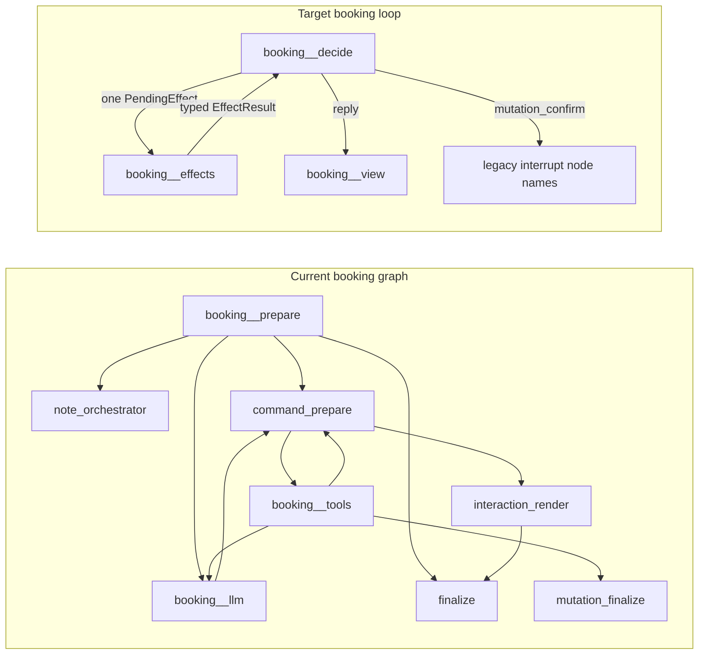

# DDD-271: Canonical booking decision loop

Source of truth: [DDD-271](https://linear.app/ddd7486/issue/DDD-271/simplify-booking-workflow-into-a-canonical-decision-loop) and children DDD-272…DDD-278.

**Baseline after fetch:** `origin/master` = `origin/dev` = `cac0b87` (PR #47 / agent-loop). Newer than the `1877570` noted in DDD-272.

## Delivery (blocking)

Do **not** ship the program as one PR. Compatibility deployment and compatibility removal cannot share a merge.

- **One PR per Linear phase** (stacked PRs are fine). Minimum split if a phase is subdivided: **DDD-278A** (cutover prep / compatibility deploy) vs **DDD-278B** (post-window cleanup).
- Each merged PR must: compile (`pnpm check`), pass `pnpm test` and `pnpm depcruise`, leave the graph loadable for in-flight checkpoints, and document rollback.
- Suggested branches from current `master`/`dev`: `cursor/ddd-272-…` through `cursor/ddd-277-…`, then `cursor/ddd-278a-…`. Open **DDD-278B** only after observed schema-0/1 volume is zero or an offline migration has completed.
- After each PR: focused graph tests plus the suite above. Run `pnpm test:all` only if `packages/llm-gemini` changes (it should not).
- Do **not** add a second booking path, third specialist, saga/event bus, interaction stack, or a second **writable** checkpoint representation.



## Module map (today)

Workflow truth is split across:

- [`src/graph/booking-draft.ts`](src/graph/booking-draft.ts): checkpointed `BookingDraft` (`phase`, service, slot, note, contact, `pendingCommand`, replacement). `bookingDraftPhase()` is already derived but **also stored**.
- [`src/graph/booking-session.ts`](src/graph/booking-session.ts): `BookingSessionState = { bookingDraft, pendingInteraction }` plus UI constructors. **No canonical aggregate type yet.** `pendingInteraction` persists ordinary DATE/TIME/contact/confirm UI.
- [`src/graph/state.ts`](src/graph/state.ts): extra channels `availabilityContext` / `availabilityCursor`, `bookingContext` / `contactContext`, `lastHandoff`, `noteOrchQueued`, `faqSkipLlm`, `bookingSkipLlm`, `serviceChangeNotice`, `pendingCancellationPurpose`, deprecated v0 projections.
- Planner: [`src/graph/agent-loop/booking-command.ts`](src/graph/agent-loop/booking-command.ts) `resolveBookingCommand`.
- Adjacent policy: prepare, note orch, contact-command, finalize, interaction render/restore, supervisor sticky.
- Safety that must stay: informational LLM allowlist in [`src/tools/index.ts`](src/tools/index.ts); runtime stamp in command-prepare; consultation tool guard; exact-slot revalidate; HITL interrupt before ToolNode; fail-closed contact identity.

HITL today pauses inside ToolNode (`booking__tools`) via `interrupt({ type: "confirm_booking", … })` in [`src/tools/meeting-confirm.ts`](src/tools/meeting-confirm.ts). Paused checkpoints bind LangGraph **task/interrupt metadata to that node name**, not only to `pendingCommand` / `mutation_confirm` in channel state.

## Smells (evidence)

1. Dual stage: stored `BookingDraft.phase` vs `bookingDraftPhase()`.
2. Dual UI authority: `pendingInteraction` vs draft facts vs `lastHandoff.replyButtons`.
3. Dual planner invocation: `resolveBookingCommand` in routers and `command_prepare`.
4. Policy in graph-node order.
5. Sticky routing + one-turn flags stand in for a decision tag.
6. Name clash: `BookingSessionState` / `reduceBookingSession` are draft+UI helpers.

## Options

1. **Phased in-place collapse with stacked deployable PRs (chosen).**
2. Parallel new booking graph — forbidden.
3. Keep topology, only rename types — does not remove synchronized projections.
4. One PR for all phases including cleanup — **rejected** (blocks rollback and leftover 0/1 checkpoints).

---

## Cross-cutting designs (apply from the phase that introduces them)

### Canonical channel cutover (Phase 1)

Evolve the existing authoritative channel **in place**:

```ts
bookingDraft: BookingSessionV2 | null
```

Do not add a second writable `bookingSession` channel in Phase 1. Rename the annotation only later (Phase 6B) if the name still pays for itself after all consumers use `BookingSessionV2`.

Atomic rule for the Phase 1 commit:

- Every booking **writer** goes through one session transition and persists only `bookingDraft` (v2).
- A temporary adapter may **project** legacy-shaped reads (`pendingInteraction`, availability cursor fields, replacement flags) from the canonical session so existing nodes keep compiling.
- The same adapter may **translate** old node updates into a canonical transition, then persist the aggregate.
- It must **not** dual-write two checkpoint representations (no “write v2 and also mutate independent `pendingInteraction` / slot projections as source of truth”).
- CRM read models (`contactContext`, `bookingContext`, `availabilityContext` slot cache) remain read models. After upgrade they are dirty / unverified as specified below; they are not a second workflow aggregate.

### `PendingDecision` (introduced in Phase 1)

Phase 1 defines ownership of waiting-on-patient state. Ordinary DATE/TIME/contact/service_confirm cards are **not** independently owned by `pendingInteraction`.

```ts
type PendingDecision =
  | { kind: "service_candidate"; /* irreducible catalog ambiguity */ }
  | { kind: "visit_select"; /* irreducible visit target / action */ }
  | { kind: "service_or_note"; /* irreducible dual parse */ }
  | { kind: "mutation_confirm"; action: "create" | "reschedule" | "cancel"; effectId: string }
  | { kind: "clarification"; reason: string };
```

- `PendingDecision` lives on `BookingSessionV2`.
- Graph/Telegram `pendingInteraction` is a **projection** of `PendingDecision` + derived view inputs, written only by the session adapter.
- Phase 3 may stop persisting derived cards entirely; Phase 1 already forbids independent mutation of ordinary UI.
- Contact-field vs mutation-confirm exclusivity is an aggregate invariant from Phase 1.

### Effect correlation and idempotency (contract in Phase 0, enforced in Phase 2)

Revision-only loop prevention is not enough (revision can change; crash between execute and checkpoint). Persist:

```ts
type PendingEffect = {
  id: string;
  expectedRevision: number;
  effect: BookingEffect;
  status: "prepared" | "executing" | "completed" | "unknown";
};
```

Rules:

- One pending effect at a time.
- Results must match `effect.id`.
- Completed effects cannot be emitted again.
- Read effects may retry under policy.
- A write with `unknown` outcome triggers **fresh CRM verification**, never blind replay.
- Frozen mutation command and `effect.id` stay stable across HITL resume.

This is command idempotency, not event sourcing.

### ToolNode is an adapter only (Phase 5; prepare in Phase 2)

If ToolNode is retained:

```
BookingEffect
  → adapter-local stamped tool call (allowlist + runtime stamp)
  → ToolNode
  → validated ToolMessage
  → typed EffectResult
```

Neither `decideBooking` nor `BookingSessionV2` inspects the message tape. A direct typed executor is allowed later; keeping ToolNode is fine if the protocol stays isolated.

**Relocate stamp/allowlist before deleting `command_prepare`.** Today that node is the safety boundary. Phase 5 must land the adapter (e.g. `stampBookingEffect` next to `booking__effects`) in the same PR that removes planner `command_prepare`, or earlier.

### Paused LangGraph interrupts (document in Phase 0; prove in 5 + 6A)

Clearing `pendingCommand` / `mutation_confirm` in hydration **does not** retire a paused interrupt. LangGraph can resume an old task by **node name** before any hydrate helper runs.

Compatibility-release strategy:

1. **Keep the compiled node names** that existing interrupts point at (`booking__tools` and any other interrupt site inventory). Phase 5 may add `booking__decide` / `booking__effects` but must retain aliases or the original names as the HITL resume target through 6A.
2. Resume adapter: if the resumed task is a legacy `confirm_booking` interrupt, **do not perform the CRM write**. Convert to expired-confirmation recovery (preserve compatible facts, mark slot unverified, drop frozen command, ask the patient to confirm again on a **new** v2 interrupt).
3. Prove with a checkpoint fixture: serialize a paused HITL `MemorySaver`/`SqliteSaver` row from today’s topology, load it on the Phase 5 graph, and assert recovery — not silent approval and not an unhandled missing-node error.
4. Do **not** claim “recover on the next patient turn” as sufficient until that load path is tested.

Inventory interrupt sites in Phase 0 (read-only): [`meeting-confirm.ts`](src/tools/meeting-confirm.ts), command-prepare comments about checkpoint-before-interrupt, `booking__tools` / `booking__mutation_finalize`.

### `UnderstoodBookingTurn` as a bounded semantic patch (contract Phase 0; use Phase 4)

A singular `workflowInput` cannot represent “Book Botox next Friday at 13:00, my phone is …, and what does it cost?”

```ts
type UnderstoodBookingTurn = {
  serviceIntent?: ServiceIntent;
  scheduleIntent?: ScheduleIntent;
  note?: NoteInput;
  contactFacts?: Partial<ContactPatch>;
  choice?: SemanticChoice;
  informationalQuestion?: string;
  controlIntent?: ControlIntent;
};
```

Canonical application order and conflicts:

1. `controlIntent` (menu, abandon, handoff, HITL yes/no)
2. explicit service change (invalidate incompatible downstream facts only)
3. `scheduleIntent`
4. `note`
5. `contactFacts`
6. `informationalQuestion` (read-only FAQ capability; resume derived view)

Conflicting service+choice, or two times, fail closed to `clarification`. Not an event bus.

---

## Phase 0 — Freeze behavior and contracts (DDD-272) — PR 1

**Goal:** No production behavior or checkpoint-shape change. Lock contracts and **passing** characterization.

**Do**

- This file: target loop, non-goals, schema 0/1/2 policy, interrupt-resume strategy, stacked PR sequence, 6A vs 6B gate, rollback (restore app + pre-cutover DB; no in-place schema-2 downgrade).
- `src/graph/booking-domain/` compile-only, unused by routing:
  - `BookingSessionV2` sketch, `PendingDecision`, `PendingEffect`, `BookingEffect` / `EffectResult`, `BookingDecision`, `BookingView`, `UnderstoodBookingTurn` (semantic patch), `nextBookingRequirement` signature
- Depcruise: `src/graph/booking-domain/**` must not import `@langchain/*` or LangGraph.
- Characterization of **current** behavior only, all tests **passing**. Extend existing files; fill DDD-272 high-risk paths when current code already implements them:
  - consultation vs named procedure, availability exact/nearest/empty/stale, combined date/time, notes, contacts, HITL, replacement, FAQ-during-booking as today’s sticky/catalog detour, visit status, abandon
- **Reusable fixtures** for desired later scenarios (multi-fact create, hours/address aside during DATE/TIME, paused HITL checkpoint blob). These fixtures are data, not failing assertions.
- Document target acceptance for those fixtures against Phase 4 / 6A in this analysis doc.
- Four **current** invariants, passing:
  1. selectable slot requires availability provenance
  2. no meeting mutation without prerequisites
  3. no success copy without committed evidence
  4. informational FAQ path as implemented today does not clear accepted facts (assert actual sticky/catalog behavior)
- Record baseline command results in this analysis doc. Do not weaken assertions. List pre-existing failures separately if any.

**Do not:** add skipped or failing tests for Phase 4 resume-loop behavior.

**Out of scope:** schema, nodes, routing.

**Rollback:** revert the PR; production checkpoints unchanged.

### Phase 0 execution record (DDD-272)

**Branch:** `cursor/ddd-272-freeze-booking-behavior-and-define-decision-contracts` from `origin/dev` @ `cac0b87`.

**Contracts (compile-only, unused by routing):**

| Module | Symbols |
|--------|---------|
| [`src/graph/booking-domain/session.ts`](../src/graph/booking-domain/session.ts) | `BookingSessionV2`, `PendingDecision`, slot/contact/note facts |
| [`src/graph/booking-domain/effects.ts`](../src/graph/booking-domain/effects.ts) | `PendingEffect`, `BookingEffect`, `EffectResult` |
| [`src/graph/booking-domain/decision.ts`](../src/graph/booking-domain/decision.ts) | `BookingDecision`, `BookingView`, `BookingInput`, `BookingReadModels` |
| [`src/graph/booking-domain/turn.ts`](../src/graph/booking-domain/turn.ts) | `UnderstoodBookingTurn` semantic patch |
| [`src/graph/booking-domain/requirement.ts`](../src/graph/booking-domain/requirement.ts) | `nextBookingRequirement` signature (throws until DDD-273) |

Depcruise rule: `booking-domain-no-langchain` forbids `@langchain/*` under `src/graph/booking-domain/`.

**Interrupt inventory (read-only):**

| Site | Role |
|------|------|
| [`src/tools/meeting-confirm.ts`](../src/tools/meeting-confirm.ts) | Sole production `interrupt({ type: "confirm_booking", … })` |
| `booking__tools` (ToolNode) | Compiled node name bound into paused checkpoint task metadata |
| [`src/graph/agent-loop/command-prepare.ts`](../src/graph/agent-loop/command-prepare.ts) | Checkpoints mutation command + `mutation_confirm` **before** ToolNode HITL |
| [`src/graph/agent-loop/mutation-finalize.ts`](../src/graph/agent-loop/mutation-finalize.ts) | Post-tool finalize; does not interrupt |
| [`src/composition/booking-hitl.ts`](../src/composition/booking-hitl.ts) | Adapter resume facade for Telegram |

Clearing `pendingCommand` / `mutation_confirm` in hydration does **not** retire a paused interrupt. Phase 5/6A must keep `booking__tools` (or alias) and prove expired-confirmation recovery on a serialized paused row.

**Characterization map (current behavior — existing + Phase 0 tests):**

| High-risk path | Primary coverage |
|----------------|------------------|
| Consultation vs named procedure | `booking-entry-policy.test.ts`, `booking-session.test.ts` |
| Availability exact/nearest/earlier/later/empty/stale | `agent-loop-availability.test.ts`, `agent-loop-booking-schedule.integration.test.ts`, draft availability helpers |
| Combined date/time | `booking-draft.test.ts` (`schedule_requested`) |
| Note answered/skipped | `booking-draft.test.ts`, `booking-session.test.ts`, `booking-note-*.test.ts` |
| Contacts new/incomplete/linkable/occupied/ambiguous | `booking-draft.test.ts`, `command-prepare.test.ts`, contact tool tests |
| HITL create/reschedule/cancel committed/declined/pending/failed/malformed | `agent-loop-booking-hitl.integration.test.ts`, `meeting-tools.test.ts`, `agent-loop-mutation.test.ts` |
| Replacement | `booking-draft.test.ts`, HITL/reschedule integrations |
| FAQ during booking (sticky / catalog_detour) | `supervisor-sticky.test.ts`, `booking-session.test.ts`, `booking-domain-invariants.test.ts` |
| Visit status / menu / abandon / handoff | supervisor + entry-policy tests |
| Four architectural invariants | `booking-domain-invariants.test.ts` |

**Reusable later-phase fixtures** ([`src/graph/__tests__/fixtures/ddd-272-later-phase.ts`](../src/graph/__tests__/fixtures/ddd-272-later-phase.ts)):

| Fixture | Phase 4 / 6A target acceptance |
|---------|--------------------------------|
| `multiFactCreatePatch` | Phase 4: one turn applies service+schedule+phone in canonical order without abandoning the session |
| `hoursAsideDuringDateSelect` / `addressAsideDuringTimeSelect` | Phase 4: informational FAQ is read-only; DATE/TIME pending decision + accepted facts preserved |
| `pausedHitlCheckpointMeta` | Phase 5/6A: load paused `confirm_booking` on `booking__tools`; expired-confirmation recovery; no CRM write; no missing-node error |
| `sketchSessionAfterServiceAccepted` | Composition aid for Phase 1+ session tests (not a production checkpoint) |

**Baseline commands** (Phase 0 implementation on this branch):

| Command | Result |
|---------|--------|
| `pnpm check` | exit 0 |
| `pnpm exec vitest run src/graph/__tests__/booking-domain-invariants.test.ts` | 9 passed |
| `pnpm test` | 81 files / 1379 tests passed |
| `pnpm depcruise` | 0 errors; 2 pre-existing `no-orphans` warnings (`checkpoint-persist.test.ts`, `langfuse-export.integration.test.ts`) |

Pre-existing failures: none. Do not weaken assertions if suite drifts — list new failures separately.

---

## Phase 1 — Canonical session in `bookingDraft` (DDD-273) — PR 2

**Goal:** One writable workflow aggregate. Topology unchanged. Deployable compatibility reader/writer.

**Do**

- Replace the `BookingDraft` **type** of `bookingDraft` with `BookingSessionV2` (schemaVersion 2, `revision`, facts listed in DDD-273, plus `pendingDecision` and optional `pendingEffect: null` placeholder).
- `nextBookingRequirement(session, readModels)` replaces stored `phase`.
- Upgrade at one hydration boundary ([`booking-checkpoint-upgrade.ts`](src/graph/booking-checkpoint-upgrade.ts), [`composition/booking-checkpoint.ts`](src/composition/booking-checkpoint.ts)):
  - read 0/1/2; **write 2 only**
  - merge draft + interaction + availability/replacement/cancel + legacy projections
  - legacy selected slots **unverified**; drop cached slot arrays; cursor is not proof
  - contact/meeting ids are candidates; mark CRM contexts dirty
  - never fabricate consultation acceptance or CRM entities
  - **do not treat hydration as HITL retirement** — preserve enough facts for the resume adapter; do not replay approval
- Adapter: old nodes keep compiling via projected reads; updates funnel into one reducer; persist only v2 `bookingDraft`.
- Keep legacy annotation **keys** (`pendingInteraction`, `availabilityContext`, deprecated v0 fields) on `ClinicState` so the upgrader can still **read** old checkpoints. After hydrate, those keys are projections or nulls, not a second write path.
- Migration fixtures: valid, partial, legacy, contradictory, malformed, double-upgrade.
- Scanner **stub** only (full scanner is 6A).

**Done:** no dual-write; `PendingDecision` owns irreducible waits; characterization green; schema 0/1 still deserializable.

**Rollback:** previous app + pre-deploy checkpoint backup. No in-place v2 downgrade.

---

## Phase 2 — Pure `decideBooking` kernel (DDD-274) — PR 3

**Goal:** Deterministic kernel owns progression. Old graph topology remains; adapter maps kernel output to today’s nodes.

**Do**

- `decideBooking(session, input, readModels): BookingDecision`.
- Port policy from `resolveBookingCommand`, contact ladder, consultation, replacement, revalidate, stale recovery, notes, HITL.
- Precedence: control → accepted facts / `PendingDecision` → service/schedule → note → identity → revalidate → confirmation/mutation → terminal.
- Emit at most one `BookingEffect`, wrapped as `PendingEffect` (`prepared`) before the adapter executes.
- `resolveBookingCommand` becomes a wrapper onto `BookingCommandOutcome`.
- Kernel never sees `BaseMessage`, `Command`, node names, prompts, `lastHandoff`.

**Tests:** transition table including malformed/repeated/`unknown` write outcomes (verify, don’t replay); domain tests import only `booking-domain`.

**Rollback:** revert PR 3; v2 checkpoints remain valid for Phase 1 app.

---

## Phase 3 — Derive views (DDD-275) — PR 4

**Goal:** Ordinary UI from post-transition session + `PendingDecision`. Persist only irreducible ambiguity and real HITL.

**Do**

- `projectBookingView(...)`.
- Derive service_confirm, date_select, time_select, visit_note, contact_field.
- Persist `PendingDecision` kinds from Phase 1; stop treating derived cards as independently restored truth.
- Stable semantic choice ids; UK/EN + RU aliases; ordinals vs current choices only.
- Mutation copy from the frozen command + stable `effectId`.
- Render/restore/finalize consume the view. Restore still must not rebuild mutation_confirm from a command without a compatible interrupt.

**Rollback:** revert PR 4.

---

## Phase 4 — Structured turn interpreter (DDD-276) — PR 5

**Goal:** Multi-fact turns and side questions do not abandon the booking.

**Do**

- Deterministic first: choice ids/labels/ordinals, phones, snapshot-grounded date/time, control, HITL.
- One structured LLM interpreter → `UnderstoodBookingTurn` semantic patch. Fold note + contact-name classifiers; do not keep three forever.
- Apply patch in the canonical order above; then informational FAQ as read-only capability (no durable FAQ ownership unless explicit browse/service-change).
- Interpreter failure → preserve session + clarification; no tools/mutations.
- `human_handoff` never claims a person was contacted if no channel exists.

**Tests:** table-driven UK/EN/RU. **Update** Phase 0 characterization tests that described old FAQ-detour behavior so they now pass the resume-loop contract. Add new passing invariants. Do not leave skipped old tests.

**Rollback:** revert PR 5.

---

## Phase 5 — Collapse graph orchestration (DDD-277) — PR 6

**Goal:** Thin LangGraph adapter. **Compatibility topology for interrupts remains.**

**Do**

- `booking__decide`: patient or typed `EffectResult` → interpreter if needed → `decideBooking` → route on decision tag.
- Effect path: stamp/allowlist adapter (moved off `command_prepare`) → ToolNode **or** typed executor → `EffectResult` → back to decide. Message tape stays adapter-local.
- Delete planner-only prepare, note-orch routing, interaction-render as policy, free-running booking LLM tool loop, duplicate finalize, one-turn domain flags. Sticky `lastHandoff` is not domain control.
- **Retain compiled names** of interrupt-capable nodes (`booking__tools` at minimum) as the resume target, even if internally they only run the stamp+ToolNode adapter. Add an explicit resume test: old paused checkpoint loads.
- On legacy confirm resume: expired-confirmation recovery, no write.
- Supervisor/FAQ/visit-status unchanged in role. `lastHandoff` remains adapter presentation.

**Do not in this PR:** remove `pendingInteraction` / v0 annotation keys required to deserialize 0/1 rows.

**Rollback:** revert PR 6 onto Phase 4 app; prefer backup if interrupt metadata was written by the new graph.

---

## Phase 6A — Cutover preparation (DDD-278A) — PR 7

**Goal:** Prove and document compatibility deployment. **Still reads 0/1/2, writes 2. Does not remove legacy channels.**

**Do**

- Non-PII scanner: counts for `already_current`, upgrade, prefetch required, slot revalidation, expired HITL, recovered partial, rejected.
- Replay: v0/v1, malformed, stale availability, replacement/reschedule, **paused HITL checkpoints** (load on the Phase 5 graph).
- Incident regressions from DDD-278 (side questions, multi-fact, empty vs closed availability, combined date/time, HITL, stale slot, contacts, mutation outcomes, status after success/fail).
- Operator docs: backup `CHECKPOINT_DB_PATH` before deploy; monitor migration outcome / effect / invariant / interpreter fallback / resumed-side-question / mutation telemetry without PII; rollback = previous application + pre-cutover DB.

**Gate to 6B (not this PR):** old-checkpoint volume is zero **or** explicit offline migration completed.

**Rollback:** previous app + backup DB.

---

## Phase 6B — Post-window cleanup (DDD-278B) — later PR

**Goal:** Remove compatibility only after the window.

**Do**

- Remove deprecated booking state channels/readers, interrupt node aliases if unused, old reducers, compatibility-only tests, leftover prompt workflow rules.
- Optional rename `bookingDraft` → `bookingSession` if every consumer is on v2.
- Update [`AGENT.md`](AGENT.md) for the final topology.

**Must not merge** while production can still present schema 0/1 rows or paused pre-v2 interrupts.

---

## Validation (every phase PR)

- `pnpm check`
- Focused graph + `booking-domain` tests
- `pnpm test`
- `pnpm depcruise`

## Explicit non-goals

No second booking specialist, generic workflow engine, event bus, permanent dual-write, CRM writes from the booking LLM, selectable slots without provenance, or removing 0/1 readers before the compatibility window closes.

## Runtime phase-read cleanup (DDD-287)

Runtime interaction policy and DATE/TIME restore now derive stage with `bookingDraftPhase`; checkpoint phase remains written and legacy readers/upgrades stay unchanged. `booking-interaction-restore` intentionally retains `draft.phase === "details"` for fresh Telegram-owned CRM contacts whose missing name fields have not yet been copied into `contactDetails`. `supervisor` uses the derived note stage while preserving the explicit `note.status === "awaiting"` fact. Remaining phase accesses are presentation/telemetry projections or compatibility validation/upgrades, plus `bookingDraftPhase`'s confirming fallback. Removing those requires an explicit schema reader/writer policy and operational scanner evidence; neither is part of this cleanup.
