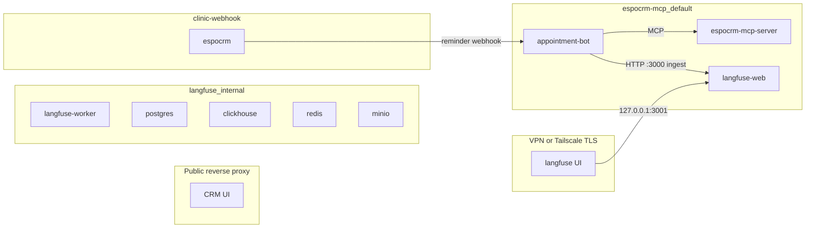

# LangSmith → self-hosted Langfuse migration design (DDD-91)

Parent: [DDD-90](https://linear.app/ddd7486/issue/DDD-90/migrate-tracing-from-langsmith-to-self-hosted-langfuse).  
Implementation: [DDD-92](https://linear.app/ddd7486/issue/DDD-92/deploy-self-hosted-langfuse-with-persistent-storage-and-access) (deploy), [DDD-93](https://linear.app/ddd7486/issue/DDD-93/instrument-the-appointment-bot-with-langfuse-tracing) (instrument), [DDD-94](https://linear.app/ddd7486/issue/DDD-94/validate-langfuse-tracing-and-complete-the-langsmith-cutover) (validate + cutover).

**Baseline:** appointment-bot `dev` at `b6188aa` (`Merge pull request #34 from slnnzmtl/fix/booking-entry-replace-menu`).  
**Scope of this document:** discovery and design only. No production deploy, no application code change, no LangSmith credential deletion.

**Open-source-only constraint:** use only the OSS Langfuse distribution and open-source SDK packages. Do not require Enterprise retention, server-side ingestion masking, project-level RBAC, audit logs, SCIM, or instance-management APIs. Automated trace retention is deferred.

---

## 1. Current-state audit

### 1.1 LangSmith integration points

| Integration | Location | Behavior |
| --- | --- | --- |
| Direct dependency | `package.json` → `langsmith@^0.8.9` | Also transitive via `@langchain/core` |
| Tier 1 sink | `src/analytics/track.ts` | `Client.createRun` child (or root) `chain` runs; `getCurrentRunTree(true)` for parent |
| Boot status | `src/index.ts` | Logs `isTracingEnabled()` / `getDefaultProjectName()`; calls `applyTracingPrivacyDefaults()` |
| Smoke privacy | `src/smoke.ts` | Same privacy defaults before runtime |
| LangGraph auto-trace | env-driven | No explicit `LangChainTracer` / callback in graph construction |
| Root turn config | `src/adapter/telegram-bot.ts` `graphInvokeConfig` | `runName: "clinic-turn"`, tags, metadata |
| Smoke roots | `src/smoke/harness.ts`, `src/smoke/scenarios/identity.ts` | tags `smoke` / `smoke:<scenario>`, `source: "smoke"` |
| Reminder analytics | `src/adapter/reminder-webhook.ts` | `reminder_sent` outside graph ALS → root run |
| Docs / env | `README.md`, `AGENT.md`, `.env.example` | `LANGSMITH_*` + legacy `LANGCHAIN_*` |
| Operator skill | `.cursor/skills/langsmith-clinic-bot/SKILL.md` | LangSmith MCP filters + peek URLs |
| Unit tests | `src/analytics/__tests__/track.test.ts` + spies elsewhere | Never hit LangSmith HTTP |
| Eval / Hub | — | No `evaluate()`, datasets API, Hub prompts, or feedback in code |
| Local eval script | `pnpm eval:booking-note` | Offline Gemini fixtures → `analysis/`; unrelated to LangSmith |
| Shutdown flush | `src/index.ts` SIGINT/SIGTERM | Does **not** flush LangSmith today |

Env vars (documented): `LANGSMITH_TRACING`, `LANGSMITH_API_KEY`, `LANGSMITH_PROJECT`, `LANGSMITH_ENDPOINT`, aliases `LANGCHAIN_*`, `LANGSMITH_TRACE_CONTENT`, `ANALYTICS_DISABLED`. Privacy helper also sets `LANGSMITH_HIDE_INPUTS` / `LANGSMITH_HIDE_OUTPUTS` via `??=` unless `LANGSMITH_TRACE_CONTENT=true`.

### 1.2 Trace structure

- One root run per Telegram / smoke message: name `clinic-turn`, `run_type: chain`.
- Tags: `telegram` (prod) or `smoke` + `smoke:<scenario>`.
- Metadata: `telegram_user_id`, `chat_id`, `source`. LangGraph `configurable.thread_id` = Telegram `chat.id`.
- Nested graph-node / LLM / tool runs from LangChain auto-tracing when tracing is on.
- Tier 1: zero-duration named child runs via `trackEvent` → `Client.createRun`, parent from ALS when present.
- `ANALYTICS_DISABLED=1` skips Tier 1 only; LLM tracing independent.
- Best-effort: `createRun` failures are logged; never fail the patient flow.

### 1.3 Privacy today

- Default when tracing on: hide LLM/tool inputs and outputs.
- Metadata and Tier 1 props remain visible (ids, counts, dates, field names, truncated `error_message`).
- Conversation-quality review for Langfuse requires **keeping** user and assistant message text; credentials, auth headers, phones, emails, full CRM payloads, and checkpoint state must be filtered **before export** (app-side + `@langfuse/otel` `mask`).

### 1.4 Live LangSmith assets (verified this design pass)

| Asset | Status |
| --- | --- |
| Project `clinic-appointment-bot` | Present; `trace_tier=shortlived`; last run `2026-10-11T17:55:22Z` |
| Billing (Base Traces) | Sep 2026: 0.22 LCSU; Oct 2026 (partial): 24.99 LCSU — low volume |
| Dataset `Issues` | Referenced by Linear bugs (five examples historically); MCP `default_dataset_id` is null — confirm/export via LangSmith UI in DDD-94 |
| Hub prompts / experiments | None found in repo or project metadata |
| Repo-managed dashboards | None |
| Private saved views / alerts | **Cannot list via MCP** — confirm manually in LangSmith UI before cutover |

### 1.5 Operational consumers

Trace-linked Linear tickets (keep old LangSmith IDs as historical references after cutover):

| Ticket | Trace / reference |
| --- | --- |
| [DDD-201](https://linear.app/ddd7486/issue/DDD-201/retain-catalog-based-consultation-consent-through-booking) | Issues dataset `01a0d3ac-af12-7c36-a2f3-0e7acd9e14bf` |
| [DDD-197](https://linear.app/ddd7486/issue/DDD-197/prevent-empty-availability-from-looping-after-an-alternative-date) | `01a0d3a7-7b37-7b1a-b73f-7afc5c52b7dd` |
| [DDD-198](https://linear.app/ddd7486/issue/DDD-198/distinguish-a-closed-day-from-an-open-day-with-no-free-slots) | `01a0d3a7-7edb-775a-b087-bda3c4045a2a` |
| [DDD-199](https://linear.app/ddd7486/issue/DDD-199/preserve-pending-booking-when-the-patient-confirms-the-appointment) | `01a0d3a8-99fb-7a5d-9983-09ab2ca1e1bd` |
| [DDD-200](https://linear.app/ddd7486/issue/DDD-200/accept-combined-ukrainian-date-and-time-slot-selections) | `01a0d3a9-c8b8-7561-9ead-3b47d1c4b411` |
| [DDD-79](https://linear.app/ddd7486/issue/DDD-79/missed-short-answer-keyboard) | “Review langsmith traces” (no peek id) |

Operator workflow: Cursor skill + LangSmith MCP (`fetch_runs`, `get_thread_history`, peek URLs). Rewrite in DDD-94 for Langfuse UI/CLI.

### 1.6 Deployment topology (code / compose — host facts pending)

Bot runtime (repo):

- Single Compose service `appointment-bot`; SQLite checkpoints; joins external networks `espocrm-mcp_default` and `clinic-webhook`.
- Sibling stacks: EspoCRM MCP, EspoCRM (MariaDB). No k8s/helm in this repo.
- Observability today: LangSmith cloud only; no Langfuse in tree.

**Live-host verification is deferred to DDD-92.** Capacity, reverse proxy (Caddy vs `nginx-proxy`), Tailscale binds, published ports, Docker log rotation, and existing backup/cron must be measured on the VPS before deploy. Do not treat an `observability/langfuse` directory as already present.

---

## 2. Audit matrix (LangSmith → Langfuse)

| Current | Action | Langfuse / follow-up |
| --- | --- | --- |
| `LANGSMITH_TRACING` + auto LangGraph | Dual-write, then remove | Keep during validation; add `@langfuse/langchain` `CallbackHandler` on every graph invoke/resume |
| `Client.createRun` Tier 1 | Replace sink | `startObservation(..., { asType: "event" })` under active OTel context |
| `getCurrentRunTree(true)` | Replace | Active Langfuse/OTel span; webhook paths create a root observation |
| `applyTracingPrivacyDefaults` | Replace | Adapter conversation I/O + `LangfuseSpanProcessor.mask` + event/tool allowlists |
| `ANALYTICS_DISABLED=1` | Keep | Skips Tier 1 only |
| `trackEvent` / `trackToolError` / `finishTrackedWrite` / test spies | Keep API | Provider-neutral boundary in `src/analytics/track.ts` |
| Boot log `isTracingEnabled` | Extend | Dual status: LangSmith on/off and Langfuse on/off |
| Skill + LangSmith MCP | Replace in DDD-94 | Langfuse UI filters + CLI; retire LangSmith MCP after cutover |
| `.env.example` / README LangSmith section | Update in DDD-93/94 | Document `LANGFUSE_*`; remove LangSmith after cutover |
| Direct `langsmith` dependency | Remove in DDD-94 | After cutover; transitive via `@langchain/core` may remain unused |
| Shutdown without flush | Fix in DDD-93 | Flush Langfuse (and dual-write LangSmith if still on) on SIGINT/SIGTERM and smoke exit |

---

## 3. Tier 1 event contract

### 3.1 Meaning of “all 30”

`TIER1_EVENTS` in `src/analytics/track.ts` is a **stable observability API**. The Langfuse sink and property allowlist must support every declared name. That does **not** mean every trace contains all 30 names.

### 3.2 `contact_lookup_telegram` (declared, not emitted)

- Declared in `TIER1_EVENTS`.
- `trackContactLookup` accepts `"contact_lookup_telegram" | "contact_lookup_phone"`.
- Only `contact_lookup_phone` is called today (`find_contact_by_phone`).
- `lookupContactByTelegram` returns search JSON **without** calling `trackContactLookup`.

**DDD-93 decision:** wire the missing emission:

```ts
trackContactLookup("contact_lookup_telegram", "lookup_contact_by_telegram" /* or tool label */, result);
```

Same props as phone: `outcome`, `tool`, optional `contact_id` / `missing_fields`. This is contract completion, not a new event name.

### 3.3 Event inventory

| Name | Source | Parent | Properties (current) | Cardinality | Privacy | Langfuse |
| --- | --- | --- | --- | --- | --- | --- |
| `contact_lookup_telegram` | `contact-tools.ts` — **unused until DDD-93** | under `clinic-turn` | `outcome`, `tool`, `contact_id?`, `missing_fields?` | per identity lookup | ids / field names | `event` |
| `contact_lookup_phone` | `contact-tools.ts` | under turn | + `has_phone` | per phone lookup | ids / field names | `event` |
| `contact_created` | `contact-tools.ts` | under turn | `outcome`, `contact_id?` | per create | id | `event` |
| `contact_telegram_linked` | `contact-tools.ts` | under turn | `outcome`, `contact_id` | per link | id | `event` |
| `contact_updated` | `contact-tools.ts` | under turn | `outcome`, `contact_id`, **`fields_updated`** (not `changed_fields`) | per update | id + field **names** | `event` |
| `contact_incomplete_blocked` | `meeting-tools.ts` | under turn | `contact_id`, `missing_fields` | per blocked book | id + field names | `event` |
| `availability_presented` | `availability-tools.ts` | under turn | `outcome`, `date?`, `slot_count`, `duration_minutes`, `searched_days?` | per present | counts / dates | `event` |
| `availability_cache_hit` | `agent-loop/nodes.ts` | under turn | `outcome`, `kind`, `date?` | per cache hit | low | `event` |
| `booking_date_selected` | `agent-loop/shared.ts` | under turn | `date` | per date pick | date | `event` |
| `booking_confirmation_requested` | `meeting-confirm.ts` | under turn | `action`, `contact_id?`, `service_id?`, `meeting_id?`, `outcome=awaiting` | per HITL show | ids | `event` |
| `booking_awaiting_chat_confirm` | `meeting-confirm.ts` | under turn | same + `outcome=awaiting` | per chat-instead-of-tap | ids | `event` |
| `booking_declined` | `meeting-confirm.ts` | under turn | same + `outcome=declined` | per ❌ | ids | `event` |
| `booking_note_step` | `shared.ts`, `nodes.ts` | under turn | `phase`, `reason?` | per note UX | enum | `event` |
| `booking_create_blocked_note` | `nodes.ts` | under turn | `phase` | per guard | enum | `event` |
| `booking_checkpoint_migrated` | `telegram-bot.ts` | under turn | `source`, `schemaVersion`, `outcome` | rare | low | `event` |
| `booking_consultation_guard` | `nodes.ts` | under turn | `phase`, `outcome` | per guard | enum | `event` |
| `booking_invariant_violation` | `nodes.ts` | under turn | `reason` | rare | enum | `event` |
| `meeting_mutation_outcome` | `mutation-finalize.ts` | under turn | `mutation`, `outcome`, `meeting_id?` | per mutation finalize | id | `event` |
| `meeting_created` | `meeting-tools.ts` | under turn | `outcome`, `contact_id`, `service_id`, `date_start`, `meeting_id?` | per commit | ids / ISO datetime | `event` |
| `meeting_cancelled` | `meeting-tools.ts` | under turn | `outcome`, `meeting_id` | per commit | id | `event` |
| `meeting_rescheduled` | `meeting-tools.ts` | under turn | `outcome`, `meeting_id`, `date_start`, `date_end` | per commit | id / datetime | `event` |
| `visit_status_response` | `visit-status.ts` | under turn | `source` | per «Мій запис» | enum | `event` |
| `reply_menu_filled` | finalize / resolve-routing / mutation-finalize | under turn | `menu`, `reason` | high | enum | `event` |
| `faq_offer_question_dropped` | `finalize.ts` | under turn | `reason` | rare | enum | `event` |
| `false_success_claim` | `finalize.ts` | under turn | `rule`, `phase`, `agent` | rare | enum | `event` |
| `supervisor_routing_decision` | `supervisor/telemetry.ts` | under turn | `path`, `intent?`, `choiceId?`, `choiceAccepted?`, `regexStatusSignal?`, `next?`, `draftDiscarded?` | per route | enum / ids | `event` |
| `tool_error` | `trackToolError` callers | under turn | `tool`, `error_message` (≤200) | per tool failure | truncated | `event` |
| `reminder_sent` | `reminder-webhook.ts` | **root** (no ALS) | `outcome`, `telegram_user_id`, `meeting_count`, `hitl`, `meeting_ids` | per webhook | ids | root `event`/trace |
| `reminder_approved` | `reminder-webhook.ts` | under turn if ALS else root | `outcome`, `telegram_user_id`, `meeting_count`, `meeting_ids` | per ✅ | ids | `event` |
| `reminder_declined` | same | same | same | per ❌ | ids | `event` |

ALS may also merge `telegram_user_id` onto any event when a graph turn is active.

### 3.4 Property allowlist (export)

Export only these keys (plus `telegram_user_id` when ALS present). Drop anything else at the analytics boundary before Langfuse:

`outcome`, `tool`, `error_message`, `contact_id`, `meeting_id`, `meeting_ids`, `meeting_count`, `hitl`, `date`, `date_start`, `date_end`, `slot_count`, `duration_minutes`, `searched_days`, `menu`, `reason`, `phase`, `path`, `intent`, `mutation`, `action`, `service_id`, `source`, `kind`, `rule`, `agent`, `has_phone`, `fields_updated`, `missing_fields`, `schemaVersion`, `choiceId`, `choiceAccepted`, `regexStatusSignal`, `next`, `draftDiscarded`.

**Do not** export: names, phones, emails, addresses, raw CRM JSON, auth headers, API keys, full graph/checkpoint state, free-text user notes inside event props.

---

## 4. Target architecture (proposed — verify on host in DDD-92)

### 4.1 Topology



### 4.2 Compose project

- **Separate** Docker Compose project on the same VPS as bot/CRM (proposed path `/home/slnnzmtl/fedchenko/observability/langfuse/` — **create in DDD-92**; not in this workspace).
- Pin images (candidate at design time): `docker.langfuse.com/langfuse/langfuse:4.56.0` and `docker.langfuse.com/langfuse/langfuse-worker:4.56.0` (latest OSS 4.x as of 2026-10-09). Never `:4` or `:latest`. Re-resolve pin at deploy time.
- Services: `langfuse-web`, `langfuse-worker`, Postgres 17, `clickhouse/clickhouse-server:25.12` (or current official pin), `redis:7`, Chainguard MinIO.
- Named volumes: postgres, clickhouse data, clickhouse logs, redis, minio.
- Private network `langfuse_internal` for all Langfuse services.
- Attach **only** `langfuse-web` to the bot’s shared Docker network (`espocrm-mcp_default` in repo compose). Bot → `http://langfuse-web:3000`. Langfuse gets **no** CRM credentials and does **not** join `clinic-webhook`.
- Proposed host bind: `127.0.0.1:3001:3000` for UI (MCP already uses host `:3000` in repo compose). Do not publish storage/worker/MinIO to the public internet.
- Memory limits: proposed budget ~8 GiB for the Langfuse stack. Official VM guidance is 4 CPU / 16 GiB / ~100 GiB disk. Clinic volume is tiny (see §1.4); co-location is intended, but DDD-92 must re-measure and record a resize/separate-host escape hatch if headroom is insufficient.

### 4.3 Access and secrets

- UI: TLS via existing reverse proxy/VPN; **Tailscale-only preferred** so conversation traces are not on the public CRM hostname. DDD-92 confirms Caddy vs other proxy and Tailscale `:443`.
- Auth: headless init (`LANGFUSE_INIT_ORG_*`, `PROJECT_*`, `USER_*`, public/secret API keys) into host `.env` mode `600`, gitignored. Then `AUTH_DISABLE_SIGNUP=true`.
- Skip SSO unless an IdP is already required (env NextAuth providers are OSS; in-UI Enterprise SSO is not).
- Leave `LANGFUSE_INIT_PROJECT_RETENTION` blank (retain forever). Automated retention deferred — no ClickHouse TTL, no schema edits, no cleanup service.
- Disable: `TELEMETRY_ENABLED=false`, `LANGFUSE_ENABLE_EXPERIMENTAL_FEATURES=false`, no in-app agent, no Langfuse AI keys, no MinIO host publish (no multimodal).
- Secrets: `openssl rand` for DB/Redis/MinIO/`NEXTAUTH_SECRET`/`SALT`/`ENCRYPTION_KEY` (64 hex). Never store secrets in git or Linear.

### 4.4 Health, logging, backup, disk

- Health: web `GET /api/public/health` and `/api/public/ready`; worker `GET /api/health`; keep upstream storage healthchecks. Redis healthcheck must authenticate (`REDISCLI_AUTH` / `redis-cli -a`) when `requirepass` is set.
- Logging: per-service `json-file` `max-size: 10m` `max-file: 5`. Do not truncate Docker JSON with external tools. DDD-92 verifies daemon defaults.
- Backups: `pg_dump`, ClickHouse native backup, MinIO `mc mirror`; off-host copy; encryption at rest on the remote; retain N copies; restore drill. Proposed RPO 24h, RTO “same-host compose up + restore”. Align with host backup conventions discovered in DDD-92 (EspoCRM rclone/cron is a candidate, not assumed).
- Disk alerts: check `/` and Langfuse volume sizes; alert before 80%. Automated trace pruning remains deferred.
- Upgrade: pin → backup → pull pin → `up` → health. Official Compose lacks HA.

### 4.5 DDD-92 live-host verification checklist

Before approving deploy:

1. `nproc`, `free -h`, `df -h`, `docker stats --no-stream`
2. Competing workloads RSS vs proposed ~8 GiB Langfuse budget
3. `docker network ls` / inspect — confirm `espocrm-mcp_default` (or live name)
4. `ss -tlnp` / `docker ps` — port conflicts (`3000`, `3001`, `8080`, `9090`, …)
5. Reverse proxy: systemd Caddy / nginx / Tailscale `:443` ownership
6. Docker log rotation (`daemon.json` or none)
7. Existing backup/cron patterns
8. Confirm production bot compose path (parent checkout vs this `dev` tree)

---

## 5. Application instrumentation (contract for DDD-93)

### 5.1 Packages (OSS scoped)

- `@langfuse/langchain` — `CallbackHandler`
- `@langfuse/tracing` — observations / events
- `@langfuse/otel` — `LangfuseSpanProcessor` with `mask`
- Required OpenTelemetry packages (`@opentelemetry/sdk-node` and/or `@opentelemetry/sdk-trace-node` as required by those packages)

Do **not** adopt the deprecated unscoped `langfuse` JS client.

### 5.2 Provider-neutral boundary

Keep `trackEvent`, `trackToolError`, `finishTrackedWrite`, and test spies in `src/analytics/track.ts`. Business code must not import Langfuse throughout the tree. New sink module (e.g. `src/analytics/langfuse.ts`) is the only Langfuse importer besides process boot.

### 5.3 Per-turn model

| Concern | Mapping |
| --- | --- |
| Trace | One Langfuse trace named `clinic-turn` |
| Session | `sessionId` = Telegram `chat.id` / LangGraph `thread_id` |
| User | `userId` = Telegram user id |
| Tags | `telegram` or `smoke` + `smoke:<scenario>` |
| Metadata | `source`; environment `production` / `development`; release = app version/git sha if available |
| Graph / LLM / tools | `CallbackHandler` on every `graphInvokeConfig` invoke and Command resume (and smoke `identity.ts` direct invokes) |
| Conversation I/O | Set **trace** input/output at the **adapter** to user text and assistant reply only |
| Tool I/O | Explicit allowlist (ids, counts, error strings); mask/drop auth, keys, phones, emails, raw MCP JSON |
| Tier 1 | `asType: "event"`, fire-and-forget, never throw |
| Webhook | No active span → root observation named `reminder_sent` |
| Best-effort | Langfuse down must not block Telegram, CRM, HITL, reminders |
| Flush | `SIGINT`/`SIGTERM` and end of `src/smoke.ts` |
| Dual-write | `LANGFUSE_TRACING` + `LANGFUSE_BASE_URL` / `PUBLIC_KEY` / `SECRET_KEY` independent of `LANGSMITH_*` |
| Conversation capture | **On** for Langfuse (self-hosted quality review); LangSmith stays redacted until disabled |
| Identity event | Wire `lookupContactByTelegram` → `trackContactLookup("contact_lookup_telegram", …)` |

Classifiers (`booking-note-classifier`, `contact-name-classifier`) inherit the parent callback when invoked inside a turn; do not add a second tracer.

### 5.4 Masking

Use open-source `@langfuse/otel` `LangfuseSpanProcessor` `mask` hook (and/or `shouldExportSpan`) plus Tier 1/tool allowlists. Do **not** depend on Enterprise server-side ingestion masking.

Keep: exact user and assistant message text needed for quality review.  
Filter before export: credentials, auth headers, unnecessary contact fields, full CRM records, unrelated graph/checkpoint state.

### 5.5 Identifiers

Keep raw `telegram_user_id`, `chat_id`, CRM `contact_id` / `meeting_id` (already in EspoCRM; required for operator debugging). Do not hash without a reverse map. Names, phones, emails, addresses stay out of events.

### 5.6 Tests (DDD-93)

- Existing `setTrackEventForTests` spies remain.
- Add: mask/redaction unit tests; webhook-root event without ALS; `contact_lookup_telegram` emission after wiring; flush called on shutdown path (unit or smoke hook).

---

## 6. Validation, rollout, rollback (contract for DDD-94)

### 6.1 Evidence checklist (representative flows)

Not a requirement that one trace contain all 30 event names:

1. Telegram `clinic-turn` with user + assistant text visible
2. Nested tool observation
3. LLM generation with token/cost where Gemini provides it
4. Funnel: `availability_presented` → `booking_confirmation_requested` → `meeting_created`
5. CRM mutation event (`meeting_*` / `meeting_mutation_outcome`)
6. `contact_lookup_telegram` on an identity turn (after DDD-93 wiring)
7. `reminder_sent` root + `reminder_approved` / `reminder_declined`
8. `tool_error`
9. Smoke tags `smoke` / `smoke:<scenario>`
10. Redaction: credential/phone not exported; conversation text is
11. Telemetry outage: stop Langfuse; bot still replies / CRM writes succeed

### 6.2 Staged rollout

1. Deploy Langfuse (DDD-92)
2. Dual-write in `dev` / smoke (DDD-93)
3. Compare trace trees, Tier 1 events, overhead
4. Enable Langfuse on production checkout
5. Observe
6. `LANGSMITH_TRACING=false`
7. Remove direct `langsmith` usage, env, skill, MCP

### 6.3 Rollback (validation window)

- `LANGFUSE_TRACING=false`; keep LangSmith env intact.
- Abort if: Tier 1 contract broken (supported names missing from sink), conversation text absent, secrets leaking, Telegram-affecting p95 latency regression, or ClickHouse/OOM on the VPS.

### 6.4 Historical data

| Asset | Decision |
| --- | --- |
| Production traces | **Clean cutover** — LangSmith `shortlived`; no automated LangSmith→Langfuse import |
| Dataset `Issues` | Export JSON archive in DDD-94; optional re-import to Langfuse datasets later |
| Linear tickets | Keep old LangSmith trace IDs as historical references |
| Cursor skill | Rewrite for Langfuse in DDD-94 |
| Private dashboards/views/alerts | Confirm none (or document) in LangSmith UI before cutover |

### 6.5 Post-cutover

Rotate/delete LangSmith API keys from bot `.env` and Cursor MCP. Do not delete the LangSmith project until the validation window ends. Disk-capacity alerts verified; automated retention remains deferred follow-up.

---

## 7. Implementation deltas for child tickets

Copy these sections into Linear after this design is approved (full detail, not one-line ACs).

### 7.1 DDD-92 — Deploy

- Create sibling compose project; pin `langfuse` / `langfuse-worker` 4.x (candidate `4.56.0`).
- Networks: `langfuse_internal` + web-only join to bot shared network; no CRM credentials.
- Host bind `127.0.0.1:3001:3000`; storage private.
- Tailscale/VPN TLS for UI; headless init; `AUTH_DISABLE_SIGNUP=true`.
- Health checks; Redis auth healthcheck; log rotation; memory limits.
- Backups (PG/CH/MinIO), restore drill, RPO/RTO; disk alerts.
- Live-host verification checklist (§4.5) before go-live.
- OSS only; retention deferred.

### 7.2 DDD-93 — Instrument

- Packages: `@langfuse/langchain`, `@langfuse/tracing`, `@langfuse/otel` + OTel deps.
- Keep `trackEvent` boundary; Langfuse sink module.
- `CallbackHandler` on `graphInvokeConfig` (+ smoke identity).
- Adapter conversation I/O; event observations; property allowlist (`fields_updated`, not `changed_fields`).
- Wire `contact_lookup_telegram` in `lookupContactByTelegram`.
- Mask hook; flush/shutdown; dual-write env; tests.

### 7.3 DDD-94 — Validate + cutover

- Full evidence list (§6.1); dual-write compare; skill rewrite; Issues JSON archive.
- Cutover / rollback; credential removal; disk-alert verification.
- “All 30” = contract support, not every name on every trace.
- Retention still deferred.

---

## 8. Decisions accepted by this design

1. Co-locate Langfuse on the same VPS as bot/CRM, subject to DDD-92 capacity verification.
2. Separate Compose project; pin OSS Langfuse v4 images; private storage network; web-only shared network with bot.
3. Tailscale/VPN UI preferred; headless init + disabled signup; no Enterprise features.
4. Preserve conversation text for quality review; filter secrets/CRM/tool dumps app-side.
5. Keep raw Telegram/CRM ids; allowlist event props including `fields_updated`.
6. Wire `contact_lookup_telegram` in DDD-93; “all 30” means contract support.
7. Clean cutover for traces; archive `Issues` dataset; rewrite operator skill in DDD-94.
8. Dual-write then disable LangSmith; flush on shutdown; telemetry never blocks patient flow.
9. Automated retention deferred; disk alerts required.

---

## 9. Out of scope (DDD-91)

- Deploying or modifying VPS services / Caddy reload
- Changing appointment-bot application code or dependencies
- Migrating production traffic or deleting LangSmith data/credentials
- Creating additional Linear tickets
